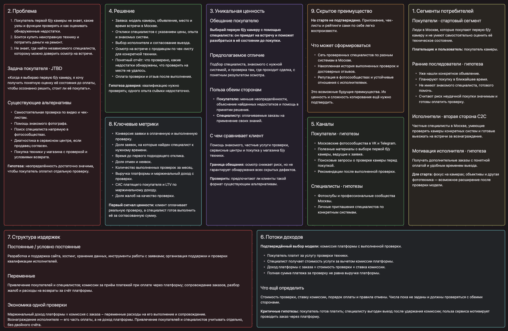

# VK_web_dev_managment_project

## Идея
"Риелторские" услуги по покупки Б/У фототехники

Проблема: Когда ты покупаешь Б/У фототехнику, особенно новой системы, то ты не знаешь, что проверять.

Решение: Приложение / сайт где зарегистрированы фотографы. Если тебе нужно что-то купить из Б/У фототехники, то ты заходишь туда, пишешь, что хочешь купить такую-то вещь, и откликнувшийся фотограф за определенную плату выезжают с тобой и проверяют вещь на месте перед покупкой.

Монетизация: Комиссия платформы с выполненного заказа
Модель взаимодействия: C2C

## Elevator pitch
### 1. Проблема
Покупая первую б/у камеру, человек часто не знает, что проверять, и боится пропустить неисправность. Найти знакомого, который разбирается в нужной системе и сможет приехать на встречу с продавцом, получается редко.

### 2. Решение
Мы предлагаем C2C-платформу для поиска специалиста по проверке фототехники. Покупатель указывает модель камеры, место и время встречи, выбирает исполнителя из откликнувшихся и заказывает выезд. Начинаем с покупателей первой б/у камеры в Москве.

### 3. Киллер-фича
Специалист, знакомый с нужной системой, приезжает прямо на встречу с продавцом, проверяет камеру по чек-листу и объясняет результат: что удалось проверить, какие недостатки обнаружены и что осталось неизвестным. Покупатель получает помощь до оплаты камеры, в момент принятия решения.

### 4. Профит
Покупатель получает понятную оценку состояния камеры и снижает риск неудачной покупки. Специалист зарабатывает на своих знаниях, а платформа получает комиссию с выполненной проверки.

### 5. CTA
Планируете купить первую б/у камеру в Москве? Пришлите объявление и желаемую дату встречи — обсудим вашу покупку и участие в пилотной проверке.

## Lean canvas

